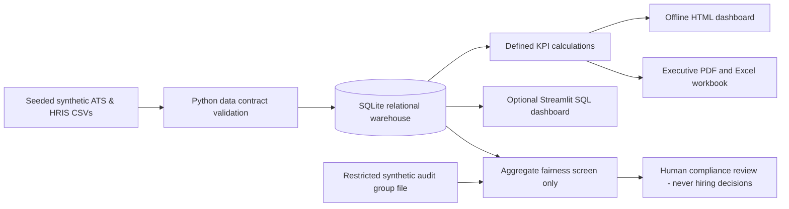
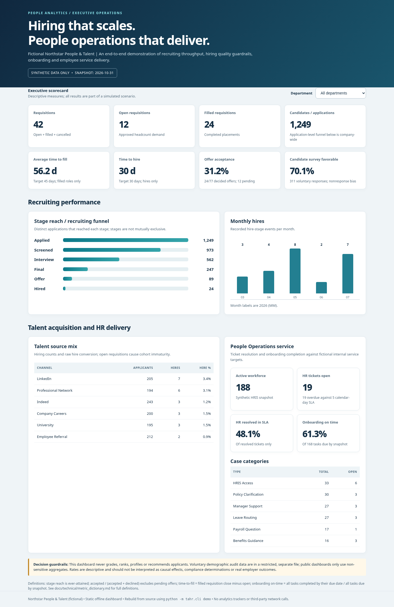
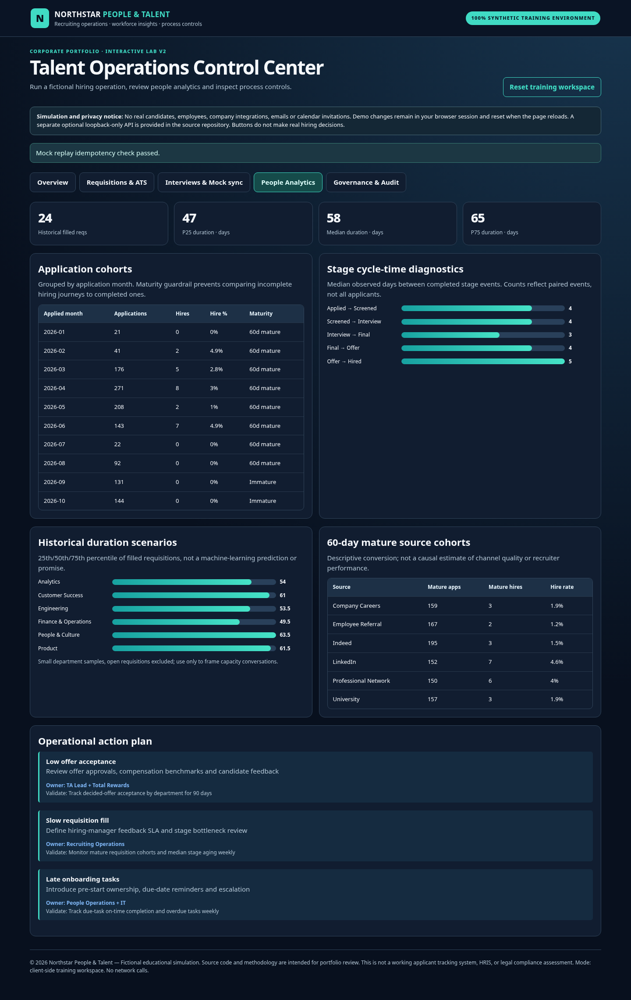

# Talent Acquisition & HR Operations | Enterprise Portfolio Lab

**An end-to-end, reproducible simulation of an in-house corporate recruiting and People Operations function.** This project demonstrates how a Talent Acquisition Coordinator / Specialist, Recruiting Operations Analyst, HR Operations Analyst, People Analyst, and HRIS/Reporting Analyst can translate an intake request into a controlled hiring pipeline, management reporting, onboarding, employee support and continuous improvement.

> **Portfolio disclosure** — **ALL company, candidate, HRIS, requisition and survey data are fictional and synthetically generated.** Northstar People & Talent is not an actual employer, client or consulting engagement. This is an executable case study, **not employment history**. The demo is not a production ATS/HRIS, a candidate scoring platform or a legal compliance tool. No external requests or messages are sent by code.

## Portfolio snapshot | 2026-10-31

| Simulated business area | Reproducible metric | What it demonstrates |
| --- | ---: | --- |
| Requisition portfolio | 42 | Intake / demand planning |
| Applications | 1,249 | ATS pipeline and stage events |
| Filled / open / cancelled reqs | 24 / 12 / 6 | Capacity, backlog and outcomes |
| Mean time-to-fill, filled reqs | 56.2 days | Service level and cycle-time analysis |
| Mean time-to-hire, hired apps | 30.0 days | Candidate journey measurement |
| Offer acceptance, decided only | 31.2% | Funnel loss and offer process improvement |
| Candidate survey favorable | 70.1% | Candidate experience, n=311 |
| Active synthetic employees | 188 | HRIS employee lifecycle |
| Onboarding on-time / due | 61.3% | Employee launch controls, 168 tasks due |
| HR service cases | 150 | Service desk categorization, backlog and SLA |
| HR resolved within 5 calendar days | 48.1% | Policy-based ticket operations, n=131 resolved |

The intentionally imperfect simulated outcomes make this an **operating improvement case**: the project identifies gaps, prioritizes corrective actions, assigns owners and defines how success would be evaluated. It does **not** claim that interventions have already worked.

### System architecture





## Interactive operations lab — enterprise v2

**[Launch the self-contained recruiting workflow](demo/index.html)** to submit and approve requisitions, log applications, advance stages, schedule fictional interviews and replay **mock-only** Greenhouse-shaped / Workday-shaped imports. Includes an action audit log and interactive advanced cohort/forecast *scenarios*. This is a safe browser simulation, not a real ATS. Refresh resets the demo. For a separate local training JSON API: `PYTHONPATH=src python -m tahr.demo_server` (loopback only; no authentication; never deploy publicly).

**New v2 executive supplement:** [`reports/enterprise_v2_executive_supplement.pdf`](reports/enterprise_v2_executive_supplement.pdf). Preview: 

**New v2 proof artifacts:** [`reports/advanced_metrics.json`](reports/advanced_metrics.json), [`templates/Advanced_People_Analytics_Cohorts.xlsx`](templates/Advanced_People_Analytics_Cohorts.xlsx), [`docs/technical/mock_integration_contract.md`](docs/technical/mock_integration_contract.md), [`docs/technical/interactive_demo_user_guide.md`](docs/technical/interactive_demo_user_guide.md), [`docs/governance/accessibility_and_security_assessment.md`](docs/governance/accessibility_and_security_assessment.md), and [`docs/strategy/enterprise_v2_improvement_case.md`](docs/strategy/enterprise_v2_improvement_case.md).

## Open the deliverables

| Asset | Path | Description |
| --- | --- | --- |
| **Offline executive dashboard** | [`reports/dashboard.html`](reports/dashboard.html) | Open in any modern browser, no install or internet; department filter, charts, KPIs |
| **Executive case study** | [`reports/executive_case_study.pdf`](reports/executive_case_study.pdf) | Actual calculated scenario data, prioritized recommendations, rollout and measurement |
| **Operational Excel workbook** | [`templates/Talent_Acquisition_HR_Operations_Workbook.xlsx`](templates/Talent_Acquisition_HR_Operations_Workbook.xlsx) | Formula-linked executive dashboard, requisition tracker, candidate pipeline, offers, onboarding, HR cases, scorecard |
| **Interactive SQL-backed dashboard** | [`app/dashboard.py`](app/dashboard.py) | Optional Streamlit, filters, tables and figures |
| **Reproducible warehouse** | [`data/processed/talent_hr.sqlite`](data/processed/talent_hr.sqlite) | Normalized relational tables, constraints, indexes, foreign keys |
| **Calculated KPI output** | [`reports/metrics.json`](reports/metrics.json) | Source-of-truth measures with traceable definitions |
| **Data QA evidence** | [`reports/data_quality.json`](reports/data_quality.json) | Automated integrity status and table counts |
| **Audit-only governance sample** | [`reports/aggregate_fairness_screen.json`](reports/aggregate_fairness_screen.json) | Anonymized high-level group screening, isolated from candidate decisions |
| **Executive assessment** | [`docs/strategy/executive_case_study.md`](docs/strategy/executive_case_study.md) | Written case narrative and corrective-action hypotheses |

## Reproduce the entire pipeline

Requirements: Python 3.10+, SQLite built into Python. The complete core uses **only the standard library**.

```bash
# Run from repository root. Offline; no API keys.
PYTHONPATH=src python -m tahr.cli demo
PYTHONPATH=src python -m tahr.advanced_analytics
PYTHONPATH=src python -m unittest discover -s tests -v
PYTHONPATH=src python scripts/verify_release.py
```

Mac/Linux users can run `make demo`, `make test`, `make validate`. Windows PowerShell: `$env:PYTHONPATH="src"; python -m tahr.cli demo`. Optional interactive app: `pip install -r requirements-dashboard.txt && streamlit run app/dashboard.py`. The offline `dashboard.html` works without installing anything.

### Why this is more than a static portfolio

1. **Operate:** write requisition briefs, open and approve jobs, source within a defined campaign, track contacts, set interview anchors, document outcomes, coordinate offers, hand off onboarding and resolve employee tickets.
2. **Measure:** compute a stage-reach funnel, source yield, cycle times, offer acceptance, candidate and manager survey signals, onboarding SLA, HR service backlog and active headcount.
3. **Govern:** use role separation and minimal data collection; keep sensitive/voluntary group records out of recruiter workflows; avoid automatic hiring decisions; require human review, process logs and retention schedules.
4. **Improve:** deliver a 30/60/90-day action plan with leading and lagging measures, review cadence, owners, risk escalation and an executive narrative.
5. **Prove:** keep the calculations, data contract, SQL, tests, executable artifacts and self-contained output together for hiring-manager review.

## Project walkthrough: show this in an interview

**Scenario:** Northstar's leadership needs to reduce slow requisition closure, improve weak offer acceptance and prevent HR case/onboarding delays while keeping selection job-related and auditable.

**Demonstration (7-10 minutes):**

1. Start `reports/dashboard.html`, highlight 42 reqs, 24 filled, 12 open and 56.2-day mean fill time against a fictional 45-day goal.
2. Show the 31.2% accepted/decided offer rate. Note that 12 pending offers are deliberately excluded, and that this is a cross-sectional synthetic scenario, not a causal result.
3. Compare source volumes and hire counts, but **do not recommend removing channels based solely on unadjusted conversion**; examine job family, cohort maturity, recruiting cost and sample size first.
4. Show on-time onboarding and HR ticket SLA performance, explain clear cross-functional ownership and escalation.
5. Open `sql/analytics.sql` and `docs/technical/metric_dictionary.md` to show traceable logic, then show tests and `reports/data_quality.json`.
6. Explain the separation of synthetic voluntary demographic audit data from operational candidate data. Never profile or rank candidates by protected characteristics.
7. Finish with the prioritized 30/60/90 plan and candidate experience safeguards.

## Repository tour

```text
app/                    optional SQL-backed Streamlit dashboard
config/                 fictional operating targets and snapshot setting
data/raw/               generated ATS and HRIS-style CSVs, no real PII
data/restricted/        separate MOCK voluntary group codes, audit-only
data/processed/         SQLite warehouse
src/tahr/               generator, loader, data QA, KPIs, audit, HTML, CLI
sql/                    relational schema + example business analyses
reports/                metrics, QA, static dashboard, executive PDF
templates/              operational workbook, recruiting communications,
                        scorecards, completed fictional examples & checklists
docs/strategy/          business case, prioritization, 30/60/90, RACI
/docs/operations/       end-to-end TA and HR SOPs
/docs/governance/       privacy, compliance, AI safeguards and risk registers
/docs/technical/        architecture, schema, KPI dictionary, QA and runbooks
/docs/career/           resume/LinkedIn/GitHub narrative and interview demo
.github/                CI quality gate and contribution templates
tests/                  reproducibility, database constraints, negative tests
```

## Technology & relevant ATS / HRIS alignment

**Implemented:** Python 3, SQLite/SQL, HTML/CSS/JavaScript, Streamlit (optional), Plotly (optional), Microsoft Excel-format workbook, ReportLab PDF, GitHub Actions CI, data governance documentation.

**Mock-only local adapters (enterprise v2):** Two illustrative, independently tested ATS/HRIS-shaped payload mappings are implemented in `src/tahr/integrations.py`. They do **not** connect to, call or authenticate with any real ATS/HRIS vendor. These are *integration simulations*, not vendor credentials or production experience.

**Conceptual mappings, NOT integrations or certifications:** Workday Recruiting, Greenhouse, Lever, iCIMS, Ashby or SmartRecruiters may implement comparable requisition, application, interview, offer and reporting concepts; Workday HCM, UKG, ADP or BambooHR may manage employee records and lifecycle tasks. **No vendor account or API is accessed or used here.** Do not claim vendor administration experience from this case study.

## Scope, ethics and safe handling

- Never paste actual resumes, salaries, background reports, SSNs, identity documents, birth dates, health records or employee addresses into this repository.
- All IDs are fabricated; sensitive personal information is intentionally absent. The restricted group CSV contains **fake Group A/B/C codes**, not real protected-category classifications, and is used only to illustrate aggregate reporting boundaries.
- There is no algorithmic candidate scoring or auto-rejection. Human-evaluated scorecard guidance emphasizes job-related, structured criteria.
- Record retention, FCRA checks, accommodations, I-9 and state/local rules require jurisdiction-specific legal/HR review before real-world use.
- Generated CSVs, warehouses, Excel and reports are **portfolio simulation evidence only** and not a substitute for a security-reviewed production HR platform.

## Documentation

Start with [`docs/technical/metric_dictionary.md`](docs/technical/metric_dictionary.md), [`docs/operations/talent_acquisition_playbook.md`](docs/operations/talent_acquisition_playbook.md), [`docs/operations/hr_operations_playbook.md`](docs/operations/hr_operations_playbook.md), [`docs/governance/compliance_sources.md`](docs/governance/compliance_sources.md) and [`docs/strategy/90_day_operating_plan.md`](docs/strategy/90_day_operating_plan.md).

**Last research check:** 2026-11-13. Linked official resources, not legal advice. MIT-licensed example code.
